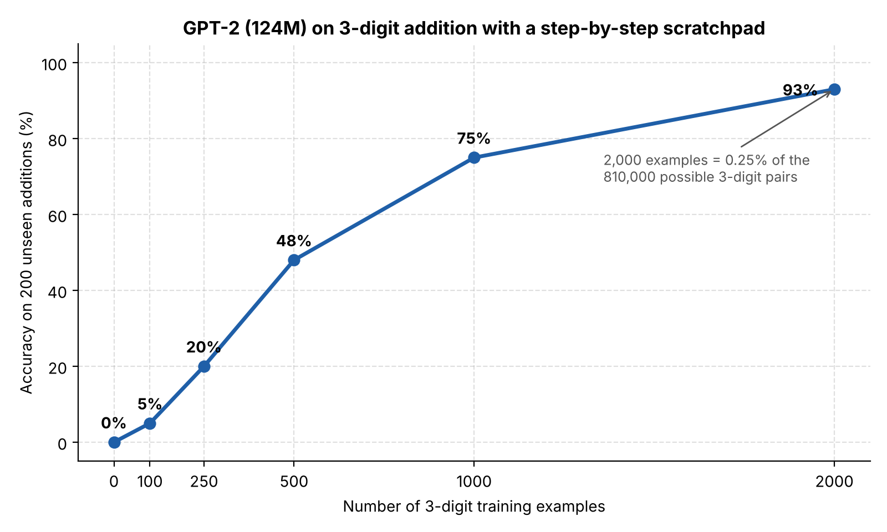
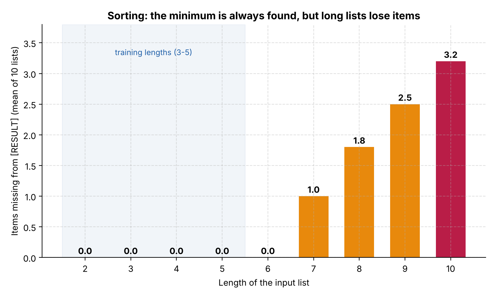

# Teaching GPT-2 to reason step by step: addition and sorting

Can a small language model learn an **algorithm** rather than memorise answers?
This project fine-tunes **GPT-2 (124M parameters)** with a *scratchpad* (chain-of-thought) format, so that the model writes out every intermediate step before giving its answer. It is applied to two tasks:

1. **Multi-digit addition**, taught progressively from 1 to 3 digits.
2. **Sorting a list of digits**, taught as a selection sort.

The work was carried out during a research internship at the **GUIA research group, Universidad del Valle (Cali, Colombia)**, from May to July 2026.

## Key results

- **93% accuracy on unseen 3-digit additions after training on only 2,000 examples**, i.e. 0.25% of the 810,000 possible pairs. With 4,000 examples (about 0.5%), the model reached **100/100**. The model before this training step solves 0%.
- On sorting, the model **always picks the correct minimum** at each step, even on lists twice as long as those seen in training. On long lists, however, it **drops items** when copying the remaining list. It learns the rule but loses track on long sequences.



## 1. Addition

### Method

The model is fine-tuned in three successive stages. Each stage starts from the model of the previous one.

| Stage | Task | Training data | Format |
|---|---|---|---|
| 1 | 1-digit + 1-digit | All 100 pairs × 5 spacing variants (500 lines) | Direct answer |
| 2 | 2-digit + 2-digit | 3,000 random pairs | Scratchpad |
| 3 | 3-digit + 3-digit | 4,000 random pairs | Scratchpad |

The scratchpad makes the column-addition algorithm explicit, including the carries:

```
483 + 725 = [THOUGHT] Units: 3 + 5 = 8. Tens: 8 + 2 + 0 = 10. Hundreds: 4 + 7 + 1 = 12. [RESULT] 1 2 0 8 <|endoftext|>
```

Other design choices:

- `[THOUGHT]` and `[RESULT]` are added as special tokens.
- Digits of the result are separated by spaces, so each one is a single token.
- Random spacing around `+` makes the model robust to how the question is typed.

Training uses the Hugging Face `Trainer`, with batch sizes of 8 to 16 and learning rates of 5e-5 to 6e-5. It ran on an iMac with Apple MPS.

### Results

The model decodes greedily, and the answer is read after `[RESULT]`.

| Model | Test set | Accuracy | Log |
|---|---|---|---|
| Stage 1 | All 100 one-digit pairs (seen in training: checks the answer format) | 98% | [`perf_1digit_98pct.txt`](addition/results/perf_1digit_98pct.txt) |
| Stage 2 | 100 random 2-digit pairs | 85% | [`perf_2digit_85pct.txt`](addition/results/perf_2digit_85pct.txt) |
| Stage 3 | 100 random 3-digit pairs | **100%** | [`perf_3digit_100pct.txt`](addition/results/perf_3digit_100pct.txt) |

**Error analysis (stage 2).** All 15 errors are on sums of 100 or more. In 10 of them the reasoning and the digits after `[RESULT]` are correct, but the model keeps generating tokens after the answer. The strict parser then rejects the output. Reading only the digits that follow `[RESULT]` would give 95%. The other 5 are real mistakes: the result is off by exactly 10, after an error in the tens column (e.g. `Tens: 8 + 8 + 0 = 17`).

**Effect of training set size.** The stage-2 model was fine-tuned on 3-digit additions with training sets of different sizes, then evaluated on 200 random 3-digit pairs (figure above):

| Training examples | 0 | 100 | 250 | 500 | 1,000 | 2,000 |
|---|---|---|---|---|---|---|
| Accuracy | 0% | 5% | 20% | 48% | 75% | 93% |

## 2. Sorting

### Method

GPT-2 is fine-tuned from the base checkpoint on 6,000 lists of 3 to 5 digits (0–9). The scratchpad unrolls a **selection sort**: at each line the model rewrites the remaining input, picks the minimum and extends the sorted list.

```
5, 2, 8 =
[THOUGHT]
Input: 5, 2, 8 | Min: 2 | Sorted: 2
Input: 5, 8 | Min: 5 | Sorted: 2, 5
Input: 8 | Min: 8 | Sorted: 2, 5, 8
[RESULT] 2, 5, 8
```

Training ran for 3 epochs, with an effective batch size of 64 and a 90/10 train/validation split.

### Results

Lists of 2 to 10 distinct digits were tested, 10 lists per length, with each output inspected manually.

- **Logic:** the minimum chosen at each step was correct in every inspected list, up to length 10. That is twice the longest training length.
- **Memory:** up to length 6 the output is perfect. From length 7 on, the model drops items when it rewrites the remaining input, and the losses grow with the length of the list. The dropped items are mostly those at the end of the input list.



This dissociation suggests the model has learned the selection rule itself. What fails is keeping track of long sequences it has never seen during training.

## Repository structure

```
addition/
  data/      dataset generators (stages 1-3, test set of 200 additions)
  train/     training scripts (stages 1-3, training-set-size study)
  eval/      benchmarks (1, 2, 3 digits; 4-digit stress test; mixed demo)
  results/   raw benchmark logs
sorting/
  data/      dataset generator (selection-sort scratchpad)
  train/     training script
  eval/      interactive inspection and long-list demo
figures/     README figures and the script that generates them
```

Trained models are not included (about 500 MB each). The scripts recreate them.

## How to run

```bash
pip install -r requirements.txt
```

All commands are run from inside the task folder. Datasets and models are written to that folder.

**Addition**

```bash
cd addition
python data/gen_data_step1.py && python train/train_step1.py   # -> gpt2-step1-addition
python data/gen_data_step2.py && python train/train_step2.py   # -> gpt2-step2-addition
python data/gen_data_step3.py && python train/train_step3.py   # -> gpt2-step3-addition

python eval/eval_1digit.py
python eval/eval_2digit.py
python eval/eval_3digit.py
python eval/stress_test_4digit.py      # generalisation to 4 digits, never seen in training
```

Training-set-size study (repeat with 100, 250, 500, 1000, 2000):

```bash
python data/gen_data_step3.py --n 500 --out dataset_3digit_train_500.txt
python train/train_scaling.py --train-file dataset_3digit_train_500.txt   # -> gpt2-step3-manual
python eval/eval_3digit_200.py
```

**Sorting**

```bash
cd sorting
python data/gen_data_sort.py
python train/train_sort.py              # -> gpt2-logique-tri
python eval/inspect_interactive.py      # choose a list length and inspect outputs one by one
python eval/demo_long_list.py
```

## Limitations

- Test pairs are drawn independently of the training pairs, with no explicit exclusion. With at most 4,000 training examples out of 810,000 possible pairs, the expected overlap with a 100-pair test set is below one example.
- The addition data generators use no fixed seed, so rerunning them gives different (equivalent) datasets.
- Test sets are small (100–200 examples), and the sorting results come from manual inspection of 10 lists per length.

## Author

**Telmo de Chambost**, M2 student in mathematics and computer science for AI, Université de Toulouse.
[LinkedIn](https://linkedin.com/in/telmo-de-chambost)
